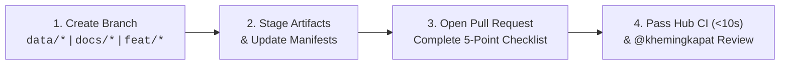

# Contributing & Data Assurance Guide (`kv_co-op_hub`)

> **Repository Role:** Central Coordination Plane, Scientific Authority & Golden Data Repository  
> **Code Execution Counterpart:** [`khemingkapat/kv_bench`](https://github.com/khemingkapat/kv_bench)  
> **Master Project Board:** [GitHub Project #9: KV-Cache Co-Optimization](https://github.com/users/khemingkapat/projects/9)

Welcome! Because `kv_co-op_hub` serves as the **single source of truth** for our Senior Project's specifications, datasets, golden benchmark results, provenance manifests, and academic deliverables, every contribution follows a strict **two-layer assurance workflow** (Automated GitHub Actions CI + Code Owner Review).

---

## 1. Quick-Start Contribution Workflow (4 Steps)

**Never push directly to `main`.** All changes—whether authored by a team member or an AI agent—must go through a feature branch and Pull Request:



### Step 1: Create a Descriptive Branch from `main`
```bash
git checkout main && git pull origin main
git checkout -b data/wp3-quantization-sweep   # Use data/*, docs/*, feat/*, or chore/*
```

### Step 2: Stage Changes & Use Conventional Commits
Tag the relevant Work Package (`[WP-1]` through `[WP-9]`) in your commit message:
* `data(wp3): stage FP8/INT4 structural sweep results and run manifest [WP-3]`
* `docs(literature): add review for new KV eviction paper [WP-3]`
* `chore(ci): update manifest validator [WP-2]`

### Step 3: Open a Pull Request & Complete the Checklist
When you open a PR targeting `main`, GitHub automatically loads [`.github/pull_request_template.md`](.github/pull_request_template.md). Complete all 5 items in the **Scientific Scope & Integrity Gatekeeping** checklist and link the parent issue (`Part of khemingkapat/kv_co-op_hub#<ISSUE_NUMBER>`).

### Step 4: Pass Automated CI & Code Owner Review
GitHub Actions ([`.github/workflows/hub-ci.yml`](.github/workflows/hub-ci.yml)) will automatically validate your PR in ~8 seconds, and `@khemingkapat` ([`.github/CODEOWNERS`](.github/CODEOWNERS)) will review and merge.

---

## 2. Repository Boundary: What Belongs Here vs. `kv_bench`?

To prevent repository bloat and confusion, keep execution code in `kv_bench` and vetted data/specifications in `kv_co-op_hub`:

| Artifact Type | Where it Belongs | Examples |
| :--- | :---: | :--- |
| **Consolidated Golden JSON Results** | ✅ **`kv_co-op_hub`** | `results/baselines/*.json`, `results/runs/<milestone>/*.json` |
| **Run & Dataset Provenance Manifests** | ✅ **`kv_co-op_hub`** | `results/manifests/run_manifest_*.json`, `dataset_manifest.json` |
| **Golden Baseline Logprob References** | ✅ **`kv_co-op_hub`** | `results/baselines/references/baseline_qwen3-4b_ref.json` *(Baselines ONLY)* |
| **Analytical Reports & Publication Figures** | ✅ **`kv_co-op_hub`** | `analysis/BASELINE_PROFILING_REPORT.md`, `analysis/figures/*.{png,svg}` |
| **Methodology Specs & Literature Survey** | ✅ **`kv_co-op_hub`** | `docs/MODELS.md`, `docs/METRICS_AND_AXES.md`, `docs/literature_survey/` |
| **Academic Deliverables (Slides, Thesis)** | ✅ **`kv_co-op_hub`** | `deliverables/s1_proposal_defense/*.pdf`, `deliverables/s2_thesis/` |
| **Benchmark Harness Code & Unit Tests** | ❌ Keep in **`kv_bench`** | `src/`, `tests/`, `benchmark.sbatch`, `pyproject.toml` |
| **Raw Slurm `.log` / `.err` Output Files** | ❌ Keep out of Git | Record the Slurm Job ID and node inside `run_manifest_*.json` instead |
| **Unmerged Per-User Intermediate Slices** | ❌ Keep out of Git | Consolidate slices (e.g., `concurrent_*users`) before staging to Hub |
| **Model Checkpoints & Raw PDF Papers** | ❌ Keep out of Git | `.pt`, `.bin`, `.safetensors`, `.gguf`, and `papers/*.pdf` are gitignored |

---

## 3. The 5 Mandatory Scientific & Integrity Rules

Every PR is checked against these 5 rules by both automated CI and reviewer sign-off:

### Rule 1: Hardware Capacity Specification
All empirical benchmarks must strictly enforce our consumer GPU memory caps:
* **Cluster Tier (CPE Slurm RTX 4090):** Capped at **16.00 GiB VRAM** (`--max-vram-gb 16.0`, `cap_fraction = 0.680`).
* **Local Tier (Desktop RTX 4060):** **8.00 GiB VRAM** (`--max-vram-gb 8.0`).
* Unconstrained 24 GB runs are only permitted if explicitly labeled as an exploratory ceiling trace.

### Rule 2: 3-Axis Co-Optimization Classification
Every contribution must state which axis of the [Metrics & Axes Framework](docs/METRICS_AND_AXES.md) it evaluates:
* **`STRUCTURAL`:** KV-cache quantization (FP8, INT4, TurboQuant, HeadQ), token eviction (H2O), or windowing (StreamingLLM).
* **`SPATIAL`:** Hierarchical CPU host DRAM offloading, PCIe transfer scheduling, and swapping.
* **`TEMPORAL`:** Cross-turn prefix caching, layer-wise prefetching, and asynchronous compute-copy overlap.
* **`CO-DESIGN`:** Unified multi-axis policy coordination.

### Rule 3: Controlled Base Models & Two Primary Quality Pillars
* **Base Model Weights vs. KV-Cache Compression:** Always use the pinned BF16/FP16 checkpoints specified in [`docs/MODELS.md`](docs/MODELS.md) (e.g., `Qwen/Qwen3-4B-Instruct-2507` @ `cdbee75f`). Do **not** load arbitrary pre-quantized GGUF/AWQ model weights from Hugging Face—base model weights must remain controlled so that memory and quality deltas isolate KV-cache optimizations.
* **Two Primary Quality Pillars:** All `STRUCTURAL` evaluations must report:
  1. **Pillar 1 (Micro-Level Logit Divergence):** `top1_agreement`, `kl_div_mean`, and `kl_div_p99` against `results/baselines/references/`.
  2. **Pillar 2 (Macro-Level LongMemEval):** Task-level accuracy and Macro F1 across the 5 core memory capabilities.
  *(Note: Token-level perplexity $\Delta\text{PPL}$ is retained strictly as an optional supplementary diagnostic.)*

### Rule 4: File Size, Binary & Logprob Bloat Guardrails (Enforced by CI)
The CI job `1. File Size, Binary & Logprob Bloat Guard` will **fail automatically** if a PR commits:
* Any single file exceeding **10 MB**.
* Any binary or log extension: `.pt`, `.pth`, `.bin`, `.safetensors`, `.gguf`, `.parquet`, `.arrow`, `.log`.
* Any `.pdf` file outside `deliverables/` (research paper PDFs must stay in gitignored `papers/`).
* Any `*_ref.json` raw per-step logprob dump outside `results/baselines/references/`. Candidate and experimental sweeps in `results/runs/` must store **only** the computed summary metrics (`top1_agreement`, `kl_div_mean`, `kl_div_p99`).

### Rule 5: Run Provenance & SHA256 Checksum Manifests (Enforced by CI)
Every benchmark dataset or result sweep staged in `results/` must be accompanied by a provenance manifest in `results/manifests/run_manifest_<name>.json`.

The CI job `2. JSON Syntax & Manifest SHA256 Provenance Verification` parses every `run_manifest_*.json` file, verifies that every path in `golden_artifacts` exists, and recomputes its SHA256 hash to guarantee zero data corruption.

#### Required `run_manifest_*.json` Schema:
```json
{
  "manifest_version": "1.0",
  "generated_at": "2026-10-25T06:06:57Z",
  "provenance_type": "baseline_run_manifest",
  "milestone": "WP-2",
  "work_package": "WP2-4",
  "target_workload": "Short description of the sweep",
  "execution_environment": {
    "cluster_node": "gpu01.slurm.cpe.kmutt.ac.th",
    "slurm_job_id": "22868",
    "gpu_model": "NVIDIA GeForce RTX 4090",
    "process_allocator_cap_gib": 16.0
  },
  "source_repository": {
    "repo": "khemingkapat/kv_bench",
    "commit_sha": "3aee66fe5dff31afe6d84a196cf963888837ebc8",
    "clean_working_tree": true
  },
  "golden_artifacts": {
    "artifact_key": {
      "path": "results/baselines/baseline_hardware_16gb.json",
      "sha256": "<64-char-hex-sha256>",
      "description": "Description of the result file"
    }
  }
}
```

> **Tip — Generate SHA256 Checksums Quickly:**
> ```bash
> sha256sum results/baselines/*.json results/runs/**/*.json
> ```

---

## 4. Run Pre-PR CI Checks Locally

Before opening a Pull Request, you can run the exact same checks that GitHub Actions runs in 2 seconds from your terminal:

```bash
# 1. Verify file sizes, forbidden extensions, and manifest SHA256 hashes
python3 - << 'EOF'
import subprocess, os, sys, json, hashlib

tracked = subprocess.check_output(["git", "ls-files"], text=True).splitlines()
bad_ext = {".pt", ".pth", ".bin", ".safetensors", ".gguf", ".parquet", ".arrow", ".log"}
errors = []

for f in tracked:
    if not os.path.exists(f): continue
    if os.path.getsize(f) > 10 * 1024 * 1024:
        errors.append(f"Over 10MB: {f}")
    ext = os.path.splitext(f)[1].lower()
    if ext in bad_ext:
        errors.append(f"Forbidden extension: {f}")
    if ext == ".pdf" and not f.startswith("deliverables/"):
        errors.append(f"PDF outside deliverables/: {f}")
    if f.endswith("_ref.json") and not f.startswith("results/baselines/references/"):
        errors.append(f"Logprob ref outside results/baselines/references/: {f}")

for jf in [f for f in tracked if f.endswith(".json") and os.path.exists(f)]:
    with open(jf) as fp: data = json.load(fp)
    if jf.startswith("results/manifests/run_manifest_"):
        for k, meta in data.get("golden_artifacts", {}).items():
            p = meta.get("path", "")
            if not os.path.exists(p):
                errors.append(f"Missing file {p} in {jf}")
            elif hashlib.sha256(open(p, "rb").read()).hexdigest() != meta.get("sha256"):
                errors.append(f"SHA256 mismatch for {p} in {jf}")

assert not errors, "\n".join(errors)
print(f"All {len(tracked)} tracked files and manifests passed verification!")
EOF

# 2. Lint Python scripts in workloads/
uv tool run ruff check workloads/
```
