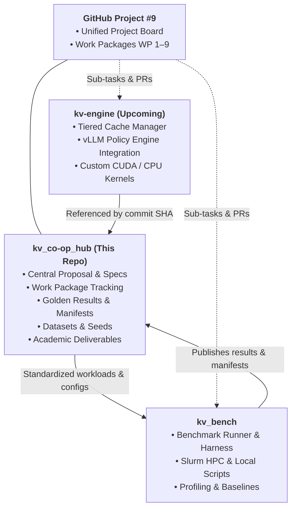

# Co-optimization of KV-Cache Management for LLM Inference on Consumer GPUs

> **Central Hub Repository** for Senior Engineering Project (Academic Year 2568, B.Eng. Computer Engineering, KMUTT).

* **Project Board**: [GitHub Project #9: KV-Cache Co-Optimization](https://github.com/users/khemingkapat/projects/9)
* **Contributor & Data Assurance Guide**: [CONTRIBUTING.md](CONTRIBUTING.md)
* **Master Proposal**: [docs/proposal.md](docs/proposal.md)
* **Roadmap & Work Packages**: [WORK_PACKAGES.md](WORK_PACKAGES.md)
* **Engineering Workflow**: [docs/WORKFLOW_SPEC.md](docs/WORKFLOW_SPEC.md)
* **Metrics & Axes Framework**: [docs/METRICS_AND_AXES.md](docs/METRICS_AND_AXES.md)
* **Baseline Profiling Report**: [analysis/BASELINE_PROFILING_REPORT.md](analysis/BASELINE_PROFILING_REPORT.md)

---

## 🎯 Project Overview

Large Language Models (LLMs) suffer from linearly growing Key-Value (KV) cache memory footprints during autoregressive decoding. On consumer-grade GPUs (8–16 GB VRAM), long-context inference (up to 32K context) quickly hits the "memory wall" or suffers severe latency penalties over standard PCIe connections.

This project addresses the **co-optimization gap** by jointly coordinating three dimensions of KV-cache optimization under strict hardware budgets:
1. **Structural Axis**: Selective compression and quantization (FP16 high-priority vs. 4-bit low-priority).
2. **Spatial Axis**: Tiered CPU host memory offloading and selective recall.
3. **Temporal Axis**: Asynchronous transfer scheduling and compute-copy overlapping to prevent GPU decode stalls.

---

## 🗂️ Repository Ecosystem



### Connected Repositories
* **[kv_bench](https://github.com/khemingkapat/kv_bench)**: Unified benchmarking harness for profiling baselines and evaluating co-optimization techniques on consumer GPUs.
* **kv-engine** *(Planned)*: The modular policy layer, tiered KV-cache manager, and runtime integration (e.g. vLLM).

---

## 📁 Repository Structure

```
.
├── CONTRIBUTING.md            # Contributor onboarding, PR rules, and CI assurance guide
├── WORK_PACKAGES.md           # Master roadmap and deliverable definitions
├── docs/                      # Core documentation & background
│   ├── proposal.md            # Approved senior project proposal document
│   ├── MODELS.md              # Pinned model registry (Pure Dense GQA vs. Hybrid)
│   ├── METRICS_AND_AXES.md    # 3-Axis framework & Two Primary Quality Pillars
│   ├── WORKFLOW_SPEC.md       # Cross-repository issue and PR engineering specification
│   └── literature_survey/     # Two-layer technical reviews across 20 papers
├── workloads/                 # Unified evaluation data & staging scripts
│   └── download_datasets.py   # Deterministic downloader for LongMemEval & PG-19
├── results/                   # Golden benchmark results & provenance manifests
│   ├── baselines/             # Verified reference data & golden logprob references
│   └── manifests/             # Run & dataset manifests with SHA256 verification
├── analysis/                  # Data analysis, profiling reports & chart generation
│   ├── BASELINE_PROFILING_REPORT.md # WP-2 empirical vs. theoretical reconciliation
│   ├── THEORETICAL_LIMITS.md  # First-principles analytical rooflines and memory bounds
│   └── figures/               # Publication-grade PNG/SVG figures for reports
└── deliverables/              # Academic deliverables & presentations
    ├── s1_proposal_defense/   # Proposal slide deck & executive summary
    ├── s1_progress_report/    # Semester 1 progress report & presentation
    └── s2_thesis/             # Senior project thesis LaTeX source & final defense deck
```

---

## 🗓️ Milestones & Work Packages

| WP | Title | Semester / Phase | Status |
|---|---|---|---|
| **WP 1** | Testbed Setup & Baseline Reproduction | Sem 1 / Phase 1: Environment & Baselines 🛠️ | 🔴 Backlog |
| **WP 2** | Hardware & System Bottleneck Profiling | Sem 1 / Phase 1: Environment & Baselines 🛠️ | 🔴 Backlog |
| **WP 3** | Multi-Axis Strategy Exploration & Candidate Benchmarking | Sem 1 / Phase 2: Exploration & Co-Design 🔬 | 🔴 Backlog |
| **WP 4** | 3-Axis Co-Optimization Policy Design & Prototype Architecture | Sem 1 / Phase 2: Exploration & Co-Design 🔬 | 🔴 Backlog |
| **WP 5** | Semester 1 Milestones, Sanity Checks & Progress Defense | Sem 1 / Phase 3: S1 Milestones & Defense 📋 | 🔴 Backlog |
| **WP 6** | Runtime Engine Integration & Output Correctness Verification | Sem 2 / Phase 4: Runtime Integration ⚙️ | 🔴 Backlog |
| **WP 7** | End-to-End Stress & Long-Context Quality Benchmarking | Sem 2 / Phase 5: Comprehensive Evaluation 📊 | 🔴 Backlog |
| **WP 8** | Ablation Studies & Performance Bottleneck Tuning | Sem 2 / Phase 5: Comprehensive Evaluation 📊 | 🔴 Backlog |
| **WP 9** | Reproducibility Artifacts, Thesis Documentation & Final Defense | Sem 2 / Phase 6: Synthesis & Thesis 🎓 | 🔴 Backlog |

For detailed breakdown and deliverables, see [WORK_PACKAGES.md](WORK_PACKAGES.md).
