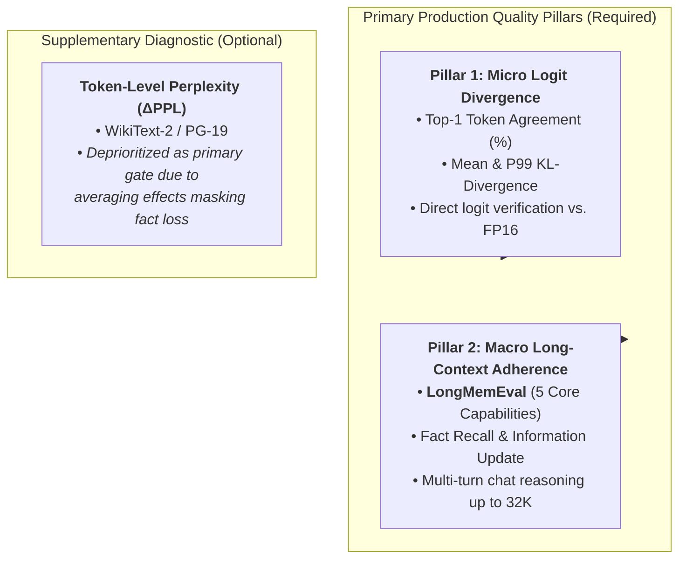

# Metrics and Co-Optimization Axes Framework

This document outlines the three co-optimization dimensions, the corresponding benchmark metrics, and the methodology for evaluating model quality degradation caused by structural KV-cache optimizations.

---

## 1. The Co-Optimization Framing

Existing KV-cache optimization techniques typically focus on a single dimension in isolation, frequently incurring hidden costs in other dimensions:
- **Offloading (e.g., FlexGen):** Optimizes memory capacity but incurs PCIe transfer latency and low throughput.
- **Prefix Caching (e.g., LMCache):** Optimizes prefill latency via reuse, but requires host RAM/storage management.
- **Eviction/Compression (e.g., H2O, FP8/INT4):** Minimizes memory footprint and memory bandwidth bottlenecks, but risks precision degradation and context loss.

Our benchmark formalizes these dimensions into three orthogonal axes defined in [`src/core/axis.py`](https://github.com/khemingkapat/kv_bench/blob/main/src/core/axis.py):

| Axis | What it Controls | Examples | Primary Bottleneck Addressed |
|---|---|---|---|
| **`STRUCTURAL`** | **How** the KV-cache is represented or compressed | Quantization (FP8, INT4), Eviction (H2O, SnapKV), Sink+Window (StreamingLLM) | GPU HBM capacity & memory bandwidth |
| **`SPATIAL`** | **Where** the KV-cache lives in the hardware memory hierarchy | Host CPU RAM swapping, NVMe offload, tiered storage | Limited GPU VRAM on consumer GPUs (e.g., 6–16 GB) |
| **`TEMPORAL`** | **When** KV data moves, is reused, or is recomputed | Prefix caching, layer-wise prefetching, asynchronous pipelining | Prefill compute latency ($O(N^2)$) & PCIe sync stalls |

---

## 2. Core Metrics and Axis Correspondence

Every run records a standardized [`ResultEntry`](https://github.com/khemingkapat/kv_bench/blob/main/src/core/metrics.py). The metrics map directly to the co-optimization axes:

| Metric | Field in `ResultEntry` | Corresponding Axis | Rationale & Trade-Off |
|---|---|---|---|
| **Peak VRAM** | `peak_alloc_mb`, `peak_reserved_mb` | `SPATIAL`, `STRUCTURAL` | Verifies whether the technique prevents Out-Of-Memory (OOM) on consumer GPUs as context scales. |
| **Host RAM Delta** | `host_rss_delta_mb` | `SPATIAL` | Offloading transfers memory pressure from VRAM to host DRAM. Measuring process RSS delta (after workload vs. before engine init) tracks the true system-level footprint. |
| **Time to First Token (TTFT)** | `ttft_sec`, `cold_ttft_sec`, `ttft_p95_sec` | `TEMPORAL` | Measures prefill latency. Reports cold vs. warm delta and P95 TTFT under 10–15 concurrent simulated users. |
| **Throughput & Inter-Token Latency (TPOT)** | `throughput_tok_per_sec`, `tpot_mean_ms`, `tpot_p95_ms` | `STRUCTURAL`, `SPATIAL` | Autoregressive decoding is memory-bandwidth bound. Measures token generation speed and detects decode stalls/jitter. |
| **PCIe Transfer Volume & Bandwidth** | `memcpy_bytes_per_token`, `memcpy_htod_bytes`, `memcpy_peak_bw_gbs` (via `--profile`) | `SPATIAL`, `TEMPORAL` | Measures normalized PCIe bus utilization and transfer volume per generated token. |
| **Logit Divergence Fidelity** | `extra["top1_agreement"]`, `extra["kl_div_mean"]`, `extra["kl_div_p99"]` | `STRUCTURAL` | Compares compressed/offloaded token probability distributions against FP16 baseline. |
| **Long-Term Memory Adherence** | `extra["longmem_acc_overall"]`, `extra["longmem_acc_<task>"]` | `STRUCTURAL` | Evaluates task-level retention on LongMemEval across 5 core capabilities. |

---

## 3. Deep Dive: Quality Measurement in the `STRUCTURAL` Axis

### Why Quality Belongs Exclusively to the `STRUCTURAL` Axis

In standard serving systems:
- **`SPATIAL` offloading** is mathematically lossless ($Q_{\text{err}} = 0$). Moving full-precision FP16 tensors to CPU RAM and restoring them to VRAM produces bit-identical logits to a purely in-VRAM execution.
- **`TEMPORAL` prefix reuse** is mathematically lossless ($Q_{\text{err}} = 0$). Reusing an identical prefix KV state bypasses recomputation without numerical distortion.
- **`STRUCTURAL` modifications** alter the tensor precision, shape, or token set:
  1. **Quantization (e.g., FP8, INT4, KIVI):** Truncates numerical precision, introducing quantization noise into attention scores and values.
  2. **Token Eviction / Pruning (e.g., H2O, SnapKV):** Selectively drops past tokens deemed "unimportant," risking the loss of needle facts or long-range dependencies.
  3. **Window Attention (e.g., StreamingLLM):** Retains only attention sinks and recent local tokens, sacrificing middle-context visibility.

Therefore, **the `STRUCTURAL` axis uniquely introduces an accuracy vs. efficiency trade-off.**

### Evaluation Strategies for Structural Techniques

To rigorously evaluate structural techniques without prohibitive evaluation overhead, the project **focuses primarily and exclusively on two core quality pillars**:



#### 1. Primary Pillar 1: Logit Divergence & Numerical Agreement (Micro-Level Fidelity)
* **Goal:** Immediate, dataset-free verification of numerical precision stability during standard test sweeps.
* **Method:** Run identical prompts through uncompressed BF16 baseline and the structural technique. Compare output logit distributions over generated steps:
  $$\text{Top-1 Token Agreement} = \frac{1}{T} \sum_{t=1}^T \mathbb{I}(\arg\max L_{\text{structural}}^{(t)} == \arg\max L_{\text{baseline}}^{(t)})$$
  $$\text{KL}(P_{\text{baseline}} \parallel P_{\text{structural}}) = \sum_{v \in \mathcal{V}} P_{\text{baseline}}(v) \log \frac{P_{\text{baseline}}(v)}{P_{\text{structural}}(v)}$$
* **Metrics:** `extra["top1_agreement"]`, `extra["kl_div_mean"]`, `extra["kl_div_p99"]`.
* **Advantage:** Requires zero external dataset ingestion; executed directly against golden reference logits (`results/baselines/references/baseline_qwen3-4b_ref.json`).

#### 2. Primary Pillar 2: Long-Term Memory Adherence via LongMemEval (Macro-Level Retention)
* **Goal:** Directly measure whether token eviction, windowing, or low-bit quantization causes long-range amnesia, hallucination, or catastrophic fact loss in realistic multi-session user chats.
* **Method:** Evaluate 50 curated multi-turn conversational histories scaled from 512 to 32K context across 5 distinct memory capabilities:
  1. **Fact Recall:** Retrieving specific details across past chat sessions.
  2. **Information Update:** Overwriting outdated memory with newer corrections.
  3. **Relative Timeframe:** Chronological reasoning across temporal markers.
  4. **Cross-Session Reasoning:** Synthesizing facts dispersed across sessions.
  5. **Unanswerable Refusal:** Refusing to answer when facts were never provided.
* **Metrics:** `extra["longmem_acc_overall"]`, `extra["longmem_macro_f1"]`, and per-task accuracies (`extra["longmem_acc_<task>"]`).
* **Advantage:** Unlike synthetic Needle-In-A-Haystack (NIAH), LongMemEval measures nuanced linguistic comprehension and conversational memory adherence under real SME assistant dialogue patterns.

#### 3. Supplementary Diagnostic: Token-Level Perplexity ($\Delta \text{PPL}$)
* **Status:** **Deprioritized as a primary evaluation gate.** Retained strictly as an optional diagnostic for autoregressive language modeling continuity on continuous text (PG-19 / WikiText-2).
* **Why Perplexity is Not a Primary Quality Gate:**
  * As established in modern KV-cache literature (e.g., *The Illusion of Equivalence*, *LoCoMo*), token perplexity computes an unweighted average of negative log-likelihood over thousands of common filler tokens.
  * Consequently, aggressive token eviction or coarse quantization schemes can easily achieve an apparently harmless $\Delta \text{PPL} < 0.2$ while completely evicting sparse needle tokens—leading to silent catastrophic failure in factual retrieval.
  * Therefore, while $\Delta \text{PPL}$ can confirm general syntactic fluency, **LongMemEval and Logit Divergence serve as the definitive arbiters of structural quality.**

---

## 4. Integration into the Benchmark Pipeline

Structural techniques record their quality metrics via the existing extensible schema:

1. **Workload Selection:** Standard latency/memory sweeps use [`SyntheticFiller`](https://github.com/khemingkapat/kv_bench/blob/main/src/core/workload.py) (with `--logprobs 5` for Pillar 1 logit checks). Macro long-context quality sweeps use [`LongMemEvalWorkload`](https://github.com/khemingkapat/kv_bench/blob/main/src/workloads/longmemeval.py) for Pillar 2.
2. **Result Storage:** Metrics flow into `ResultEntry.extra`:
   ```json
   {
     "requested_ctx": 4096,
     "status": "SUCCESS",
     "axes": ["STRUCTURAL"],
     "peak_alloc_mb": 13592.0,
     "throughput_tok_per_sec": 83.3,
     "extra": {
       "top1_agreement": 1.0,
       "kl_div_mean": 0.0,
       "kl_div_p99": 0.0,
       "longmem_acc_overall": 0.32,
       "longmem_macro_f1": 0.105,
       "longmem_acc_fact_recall": 0.60,
       "longmem_acc_information_update": 0.60
     }
   }
   ```
3. **Cross-Axis Analysis:** Plots directly correlate memory and latency gains against quality preservation (e.g., *VRAM reduction vs. LongMemEval accuracy* and *TPOT speedup vs. KL divergence* Pareto curves).
